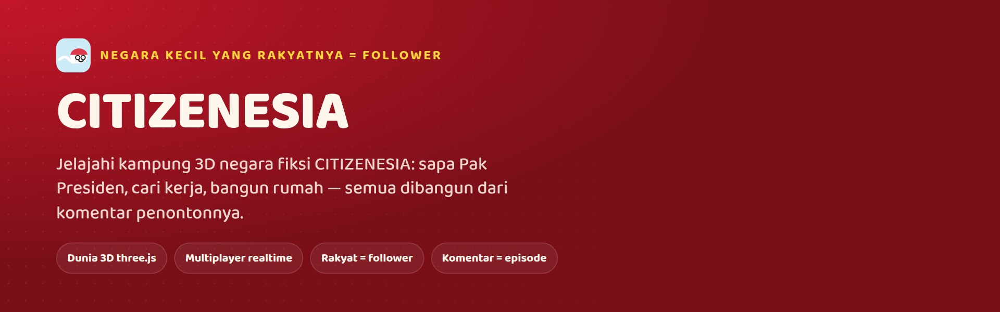
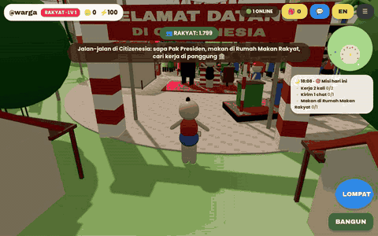
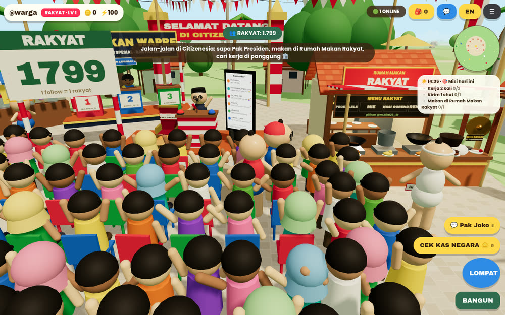
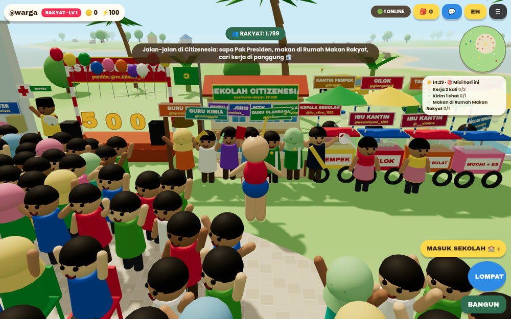
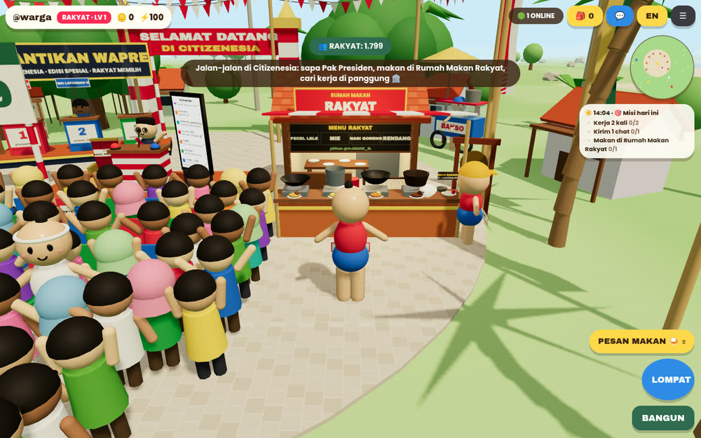
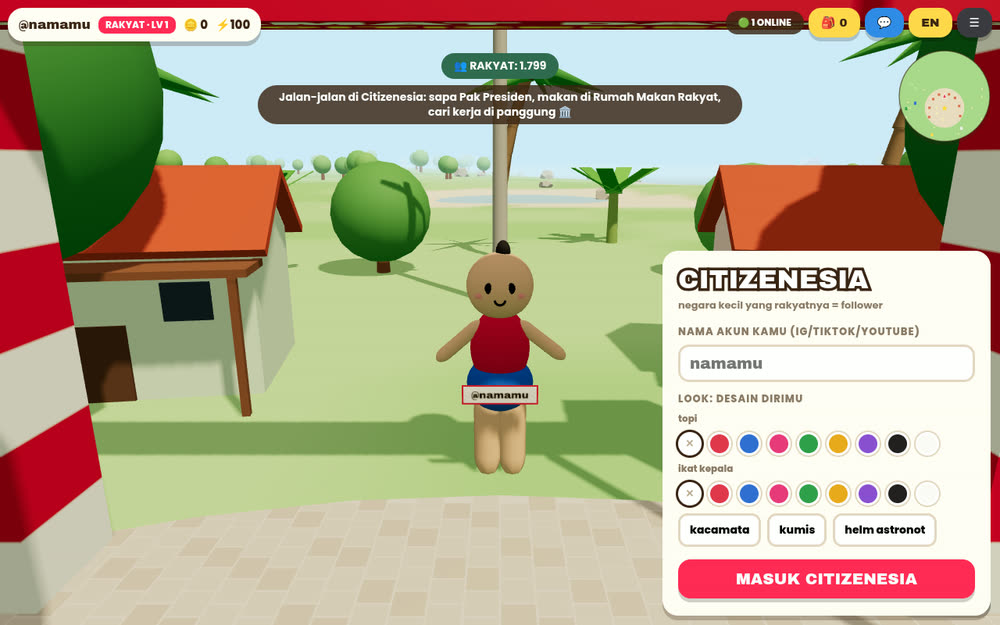

<p align="center">
  
</p>

<p align="center">
  <a href="https://citizenesia.com"></a>
  <a href="https://www.instagram.com/citizenesia.official/"></a>
</p>

<p align="center">
  
  
  
  
  
  
</p>

**CITIZENESIA** adalah negara kecil fiksi yang rakyatnya adalah penontonnya sendiri — dunia bermain dari reels [@citizenesia.official](https://www.instagram.com/citizenesia.official/). Dua aturan, sama persis seperti di videonya: **follow = kamu jadi salah satu rakyat**, dan **komentar dengan like terbanyak = yang terjadi di episode berikutnya**. Kampung di game ini adalah kampung episode terbaru, dibangun dari sumber 3D yang sama, jadi bentuknya persis seperti di reels.

## Sekilas

<p align="center">
  
</p>

<p align="center">
  
</p>

<table>
  <tr>
    <td align="center"><br><sub>Sekolah & kantin — guru dan kepsek dari komentar</sub></td>
    <td align="center"><br><sub>Rumah Makan Rakyat, menu & dapur terbuka</sub></td>
    <td align="center"><br><sub>Desain rakyatmu sebelum masuk</sub></td>
  </tr>
</table>

## Fitur utama

- **Jadi salah satu rakyat.** Pilih nama akunmu dan desain LOOK (topi, ikat kepala, kacamata, kumis, helm astronot). Mulai dari gapura "SELAMAT DATANG DI CITIZENESIA".
- **Kampung dari reels, hidup.** Pak Presiden di podium dan KURSI RAKYAT 001, Rumah Makan Rakyat, kursi Wapres, panggung debat & kotak suara, Kas Negara, rumah sakit 5 lantai dengan dokter dari komentar, sekolah, warung 24 jam, dan gerobak bakso — semua yang dibangun komentar ada di sana.
- **Semua bisa dipakai.** Ngobrol dengan Pak Presiden, duduk di kursi rakyat, pesan makan, pukul gong, cek kas negara, periksa di RS, masuk sekolah, pidato, dan cari kerja (10 koin per shift). Uangnya KOIN CITIZENESIA — uang mainan, tanpa rupiah.
- **Dunia tak berujung.** Darat dan laut dibangun per-chunk di sekitarmu dengan desa-desa di tanah tetangga; laut dalam menenggelamkanmu dan kamu bangun lagi di gapura.
- **Masuk rumah mana saja & membangun.** Tiap rumah punya pintu; di dalamnya kasur, kulkas, kompor, TV, saklar, komputer, rak buku semuanya bisa dipakai. Beli rumah jadi (kecil/sedang/besar) lalu pasang blok (1 koin per blok).
- **Dua bahasa.** Mengikuti bahasa perangkat (Indonesia/Inggris), bisa ganti lewat tombol EN/ID.

## Cara pakai

**Langsung main:** buka <https://citizenesia.com>. Butuh WebGL. Di HP, mainkan dalam posisi landscape.

| | Laptop | HP |
| --- | --- | --- |
| Gerak | WASD / panah (Shift lari) | joystick |
| Lihat sekeliling 360° | drag | drag |
| Zoom | scroll | pinch |
| Lompat / naik di air | Space | LOMPAT / NAIK |
| Pakai sesuatu | E, R, F, G | tombol kuning |
| Mode bangun | B | BANGUN |
| Pasang / hapus blok | klik / klik kanan, X ganti alat | PASANG / HAPUS |

Progres disimpan di browser (localStorage). Tambahkan `?debug` ke alamat untuk mendapat `window.__cz` saat pengujian.

**Menjalankan sendiri:**

```bash
npm install
npm run dev          # buka alamat yang dicetak Vite (juga menyimak di jaringan untuk HP se-Wi-Fi)
npm run deploy       # publikasi ke Cloudflare dengan CLI `cf` (cloudflare.config.ts)
```

## Cara kerjanya

Kampung diambil dari world source episode terbaru (`src/kampung.js`, dari `ep009sekolah-id` di folder seri), disalin dengan tiga perubahan: tanpa renderer sendiri, tanpa ground disc (tanah tak berujung jadi lantainya), dan koin mainan sebagai ganti rupiah. `src/kampung-data.js` menyimpan timing kata episode itu agar skrip tahu apa yang sudah berdiri di akhir episode. Untuk membawa episode baru, salin world source-nya dengan cara yang sama.

`public/data/world.json` menyimpan angka dari akun: `population` (jumlah follower, dipakai counter & papan RAKYAT), `day` (episode terbaru), `links.instagram` (akun yang dibuka kotak suara).

### Struktur kode

```
src/kit.js               material & papan nama bersama (sama seperti dunia video)
src/actors.js            para rakyat (figur yang sama dengan reels) + opsi LOOK
src/kampung.js           kampung episode terbaru
src/kampung-data.js      timing kata episode untuk tahu apa yang sudah terbangun
src/negara.js            lapisan game di atas kampung: tabrakan, pintu, tempat yang bisa dipakai
src/homes.js             rumah yang dibeli, pintu, dan isi rumah
src/terrain.js           darat & laut tak berujung, dibangun per-chunk
src/npc.js               warga NPC dengan jadwal harian
src/play.js              lapisan online (WebSocket, pemain lain, chat)
src/build.js             blok, bidikan, dan penyimpanan
src/sfx.js, src/i18n.js  efek suara di browser & semua teks dua bahasa
src/main.js              pemain, kamera, input, HUD, dan aturan game
worker/index.js          Cloudflare Worker + Durable Object `Room` (SQLite)
```

## v0.5 — kampung online

- **Server yang menentukan ekonomi** (`worker/index.js`, Durable Object `Room` dengan SQLite): koin, XP, energi ⚡, tas, statistik, misi harian, dan biaya bangun hanya berubah lewat aksi yang diperiksa server (`POST /api/act`). Simpanan HP (`/api/save`) menjaga look, posisi, dan bangunan.
- **Main bareng** (WebSocket `/api/room`): pemain lain, chat (dengan filter kata), emote, pesan pribadi, hadiah, satu sopir per mobil, item yang diambil bersama, serta rumah dan blok semua orang.
- **Kehidupan**: energi (makan untuk mengisi; toko buka 06:00–22:00 pada hari 24-menit bersama), menjual barang di warung, pekerjaan kurir Sopir Antar, level & gelar, papan peringkat, dan NPC warga dengan jadwal harian.
- **Admin**: `/kymind` meminta kode admin sekali; server yang memeriksanya (secret `ADMIN_KEY`). Salinan lokal di `.admin-secrets.json` / `.dev.vars` (keduanya diabaikan git). Deploy: `npm run deploy -- --secrets-file .admin-secrets.json`.

## Rencana berikutnya

- Bendera & ikon app yang dirancang penonton lewat komentar, dipilih lewat voting, dengan kredit perancangnya.
- Gedung yang terbuka di milestone follower (Kantor Sensus, Stadion Rakyat, Bandara + perjalanan ke tanah tetangga).
- Kotak komentar in-app yang online, agar sensus menghitung langsung dari app.

---

<p align="center"><sub>Dibuat oleh <a href="https://github.com/ky-Mind">ky-Mind</a> · <a href="https://kymind.web.id">kymind.web.id</a></sub></p>
